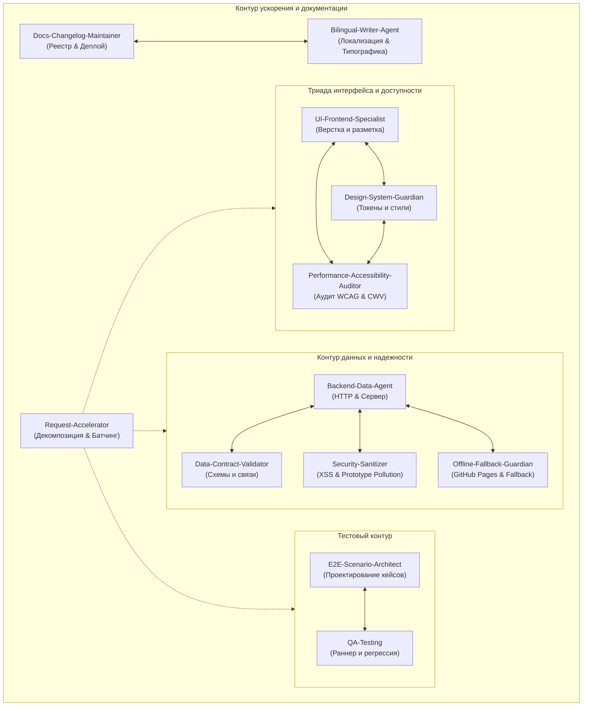

# Мультиагентная экосистема проекта «Buddie» (HR-портал для студентов)

Откалибрована для высокой скорости, чистого контекста, нулевой потери данных (**Zero Data Loss**) и стабильности под моделью **Gemini 3.8 Flash (High)** в гибридном контуре проекта.

---

## 1. Реестр специализированных ролей и навыков

| Агент / Навык | Название типа | Назначение и строгие границы | Ключевые файлы |
| :--- | :--- | :--- | :--- |
| **Backend & Data Architect** | `backend-data-agent` | Архитектура `node:http`, REST API в `src/server.js`, in-memory кэш (< 1мс), очередь мутаций, атомарная запись на Windows | `src/server.js`, `data/db.json` |
| **Data Contract Validator** | `data-contract-validator` | Схемы данных `data/db.json`, двусторонняя ссылочная целостность (Application ⟷ Candidate ⟷ Job), каскадная очистка | `data/db.json`, `data/db.json.backup` |
| **Offline Fallback Guardian** | `offline-fallback-guardian` | Автономия GitHub Pages, Circuit Breaker в `ApiService`, относительные пути (`./`), устойчивость `localStorage` | `public/js/app.js`, `public/data/db.json` |
| **UI / Frontend Specialist** | `ui-frontend-specialist` | Семантическая HTML5-верстка, CSS-архитектура страниц, адаптивность 320px–1440px без оверфлоу, жизненный цикл модалок | `public/*.html`, `public/css/*.css` |
| **Design System Guardian** | `design-system-guardian` | Токен-дисциплина в `variables.css`, запрет хардкода цветов/отступов, иерархия токенов, SVG-спрайт (`#icon-*`) | `public/css/variables.css` |
| **Performance & a11y Auditor** | `performance-accessibility-auditor` | Аудит WCAG 2.1 AA (контраст $\ge 4.5:1$, Focus Trap, Escape), Web Vitals (CLS < 0.1, LCP < 2.5s, INP < 200ms), мобильные тач-таргеты 44px | `public/css/`, `public/js/app.js` |
| **E2E Scenario Architect** | `e2e-scenario-architect` | Проектирование Playwright-тестов, стресс-кейсы, Double Submit, сетевые сбои (`page.route`), фуззинг длины полей, `@media print` | `tests/app.spec.js` |
| **Fast QA & Regression Pilot** | `qa-testing` | Оператор тестового ран-тайма, трехуровневый контур верификации, `playwright.config.js`, гейткипер чистой консоли | `tests/app.spec.js`, `playwright.config.js` |
| **Security & Data Sanitizer** | `security-sanitizer` | Защита от XSS (`escapeHTML`), Prototype Pollution (`sanitizePayload`), блокировка кнопок от повторных кликов (`aria-busy`), тримминг | `public/js/app.js`, `src/server.js` |
| **Documentation & Changelog** | `docs-changelog-maintainer` | Реестр REST API, инструкции развертывания GitHub Pages, синхронизация `.agents/README.md`, Conventional Commits | `README.md`, `.agents/README.md` |
| **Request Accelerator** | `request-accelerator` | Декомпозиция крупных задач, пакетные правки, точечные диапазоны чтения, чекпоинт-контроль (< 100 мс) | `.agents/skills/request-accelerator/` |
| **Bilingual Writing Assistant** | `bilingual-writer-agent` | Локализация RU ⟷ EN, интерфейсная микрокопия, экранная типографика («ёлочки», длинное тире, `…`), защита от омоглифов | Все текстовые ресурсы и шаблоны |

---

## 2. Архитектура взаимодействия (Co-Pilot Cross-Skill Protocol)

Агенты функционируют не изолированно, а в составе согласованных пар и триад:



### Матрица совместного контроля:
1. **[Offline-Fallback-Guardian] + [Backend-Data-Agent]:**
   Любые изменения в логике запросов `public/js/app.js` валидируются на сохранение оффлайн-работы: при недоступности API приложение бесшовно переключается на кэш и дефолты без ошибок в консоли.
2. **[Performance-Accessibility-Auditor] + [UI-Frontend-Specialist] + [Design-System-Guardian]:**
   Рендеринг карточек, диалогов и сеток сопровождается обязательной проверкой WCAG AA (контрастность $\ge 4.5:1$, Focus Trap, клавиатурный `Escape`, режим `@media print`, нулевой оверфлоу на 320px).
3. **[Security-Sanitizer] + [Backend-Data-Agent]:**
   Защита от Prototype Pollution (`sanitizePayload`), лимиты размера запроса (1 MB) и экранирование входных данных перед вставкой в базу или `innerHTML`.
4. **[E2E-Scenario-Architect] + [QA-Testing]:**
   Покрытие новых интерфейсных состояний надежными тестами Playwright без раздувания хрупких локаторов по динамическому тексту.
5. **[Data-Contract-Validator] + [Backend-Data-Agent]:**
   Соблюдение схемы `data/db.json`, целостность связей при откликах и удалениях, атомарная запись (`.tmp` ➔ Safe Rename с повторными попытками для Windows) и идентичность с `public/data/db.json`.
6. **[Docs-Changelog-Maintainer] + [Bilingual-Writer-Agent]:**
   Синхронизация двуязычной документации, точность терминологии, чистая типографика («ёлочки», длинное тире, неразрывные пробелы) и сохранение UTF-8 без BOM.

---

## 3. Гибридный контекст проекта (Dual Environment Engine)

Система разработана для бесшовной работы в двух режимах:
- **Режим A: Статическое демо на GitHub Pages (`https://straysun.github.io/Buddie/`)**
  - Сервер Node.js отсутствует.
  - Состояние хранится в браузере (`localStorage`), стартовые данные берутся из `public/data/db.json` или встроенных констант.
  - Активирован Circuit Breaker в `ApiService`, исключающий 404-спам.
  - Все пути к ресурсам — строго относительные (`./css/`, `images/`).
- **Режим B: Локальный полнофункциональный сервер Node.js (порт 4173)**
  - Запускается командой `npm run dev` или `npm start`.
  - Легковесный zero-dependency HTTP сервер на `node:http`.
  - Атомарное сохранение транзакций в `data/db.json` с автобэкапом.
  - Мгновенный in-memory кэш со скоростью ответа < 1 мс.

---

## 4. Порядок передачи контекста при выполнении задач (Workflow Pipeline)

```
[Пользовательский запрос]
         │
         ▼
[1. Request-Accelerator]: Декомпозиция задачи, выделение пакетов правок, выбор модели
         │
         ├────────────────────────┬────────────────────────┐
         ▼                        ▼                        ▼
[2. Data & Security]      [3. UI & Styling]        [4. Copy & Docs]
- Backend-Data-Agent      - UI-Frontend-Specialist - Bilingual-Writer-Agent
- Data-Contract-Validator - Design-System-Guardian - Docs-Changelog-Maintainer
- Security-Sanitizer      - Offline-Fallback
         │                        │                        │
         └────────────────────────┴────────────────────────┘
                                  │
                                  ▼
[5. Fast Verification Checkpoint (< 100 мс)]
npm run lint:syntax
                                  │
                                  ▼
[6. E2E Scenario & a11y Audit]
- E2E-Scenario-Architect (новые спеки и стресс-кейсы)
- Performance-Accessibility-Auditor (проверка WCAG AA & CWV)
                                  │
                                  ▼
[7. QA Regression Sweep]
- QA-Testing: npx playwright test -g (таргетированный запуск) / npm test (регрессия)
```

---

## 5. Трехуровневый контур верификации (Self-Healing Loop)

1. **Tier 1: Pre-flight Syntax Check (< 100 мс):**
   `npm run lint:syntax` — мгновенная проверка синтаксиса `public/js/app.js` и `src/server.js`.
2. **Tier 2: Targeted Spec Run (1–2 с):**
   `npx playwright test -g "название фичи"` — валидация конкретного затронутого сценария.
3. **Tier 3: Full Regression Sweep (перед сдачей задачи):**
   `npm test` — полный прогон всех E2E-тестов с контролем чистой консоли (Zero Console Errors).

---

## 6. Критические правила для Windows и Gemini 3.8 Flash

1. **Atomic Write on Windows:** Мутации базы данных выполняются через `.tmp` и `fs.renameSync()` с retry-циклом при ошибках `EPERM`/`EBUSY`.
2. **Strict UTF-8:** Все операции с файлами (`.js`, `.json`, `.md`, `.html`, `.css`) используют явную кодировку `'utf8'`.
3. **Robust Locators:** В тестах запрещен поиск по динамически мутирующему тексту кнопок.
4. **Token Efficiency:** Использование точечных диапазонов строк при чтении файлов и отсутствие когнитивного шума в ответах.
