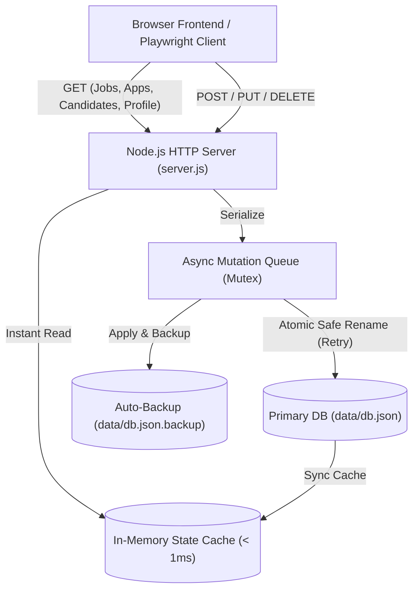

# Backend & Data Architect Agent

Специалист по серверной архитектуре, протоколам обмена данными, целостности реляционных связей в JSON-хранилище и надёжности серверных процессов на Node.js. Оптимизирован для работы под моделью Gemini 3.8 Flash по парадигме **Zero Data Loss** без риска повреждения данных или сбоев кодировок на Windows.

---

## 1. Системная архитектура (System Architecture)

Архитектура бэкенда портала спроектирована по принципу **High-Performance Zero-Data-Loss Reactive REST API**:
- **Zero-Dependency Core**: Сервер построен на встроенном модуле `node:http`, что гарантирует запуск без внешних тяжелых зависимостей (Express/Fastify), снижая накладные расходы и время холодного старта тестов до < 100 мс.
- **In-Memory Cache with Sub-millisecond Latency**: Чтение данных (`GET /api/jobs`, `GET /api/applications`, `GET /api/candidates`, `GET /api/profile`) выполняется напрямую из памяти (`< 1ms`) с проверкой `mtimeMs` для мгновенной синхронизации при внешних изменениях тестов.
- **Serialized Mutation Queue (Race-Condition Immunity)**: Все операции записи (`POST`, `PUT`, `DELETE`) обрабатываются строго последовательно через очередь транзакций `runMutation(mutatorFn)`. Это полностью исключает состояние гонки (Race Condition / Lost Update).
- **Windows-Safe Atomic Persistence**: Запись на диск выполняется по протоколу Write-to-Temp -> Auto-Backup -> Safe-Rename с экспоненциальным backoff (до 5 попыток) при перехвате ошибок блокировок Windows (`EPERM`, `EBUSY`, `EACCES`). При сбое основного файла сервер автоматически восстанавливается из `data/db.json.backup`.
- **Relational Integrity Pattern**: При изменении сущности в одном домене система автоматически поддерживает реляционную целостность:
  - *Студент откликается на вакансию (`POST /api/applications`)* ➔ Создаётся объект заявки в `db.applications` + регистрируется карточка в `db.candidates` с парными `jobId` и `id`.
  - *HR меняет статус кандидата (`PUT /api/candidates/:id`)* ➔ Синхронизируется статус отклика студента.
  - *Студент отменяет заявку (`DELETE /api/applications/:id`)* ➔ Каскадно очищаются `applications`, `appliedJobs` и `candidates` без утечек данных и 404 ошибок.



---

## 2. Спецификация контрактов данных (Data Contracts)

Файл [data/db.json](file:///c:/Users/Wanderer/Desktop/HR%20портал%20для%20студентов/data/db.json) обязан соответствовать строгой схеме:

### 2.1. Вакансии (`jobs`)
```json
{
  "id": "string (уникальный slug, например yandex-analyst)",
  "company": "string (название компании)",
  "companyLetter": "string (буква или аббревиатура для логотипа, например 'Я' или 'VK')",
  "companyLogoClass": "string (CSS-класс: company-logo--yandex | --sber | --vk | --tbank)",
  "title": "string (должность)",
  "salary": "string (диапазон ЗП, например '150 000–200 000 ₽')",
  "specialty": "string (development | analysis | other)",
  "format": "string (hybrid | remote | office)",
  "tags": ["string", "string"],
  "description": "string",
  "location": "string (город и формат)",
  "workload": "string (занятость)",
  "postedTime": "string",
  "responseBadge": "string",
  "rating": "string"
}
```

### 2.2. Заявки студентов (`applications`)
```json
{
  "id": "string (app-1, app-<timestamp>-<rand>)",
  "jobId": "string (id связанной вакансии)",
  "title": "string",
  "company": "string",
  "companyLetter": "string",
  "companyLogoClass": "string",
  "location": "string",
  "appliedDate": "string",
  "status": "string (Приглашение | На рассмотрении | Отказ | Оффер | Оффер принят)",
  "statusClass": "string (status-badge--success | --warning | --danger | --purple)",
  "actionText": "string (Выбрать время | Чат с HR | Фидбек | Принять)",
  "interviewSlot": "string (опционально, выбранное время встречи)"
}
```

### 2.3. Кандидаты для HR (`candidates`)
```json
{
  "id": "string (cand-1, cand-<timestamp>-<rand>)",
  "jobId": "string (id связанной вакансии, опционально для демо-кандидатов)",
  "name": "string (Имя и инициал студента)",
  "initials": "string (2 буквы)",
  "avatarClass": "string (CSS модификатор аватара)",
  "role": "string",
  "university": "string (Вуз и курс, например 'КФУ · 3-й курс')",
  "jobTitle": "string",
  "matchScore": "string (процент соответствия, например '94%')",
  "skills": ["string"],
  "status": "string (new | interview | review | rejected | hired)",
  "statusLabel": "string (Новый | Интервью | На рассмотрении)",
  "statusClass": "string (status-badge--success | --purple | --warning)"
}
```

---

## 3. Спецификация REST API

| Метод & Путь | Назначение | Особенности реализации |
|---|---|---|
| `GET /api/health` | Мониторинг и метрики | Возвращает статус `healthy`, аптайм и количество сущностей |
| `GET /api/db` | Полный срез базы данных | Чтение из in-memory кэша с ETag |
| `GET /api/jobs` | Список вакансий | Поддерживает Query-параметры `?search=`, `?specialty=`, `?format=`, `?university=` |
| `GET /api/jobs/:id` | Вакансия по ID | Возвращает 200 или 404 |
| `POST /api/jobs` | Создание вакансии HR | Автогенерация ID, бейджей, аккредитации КФУ |
| `PUT /api/jobs/:id` | Редактирование вакансии | Атомарное обновление через очередь |
| `DELETE /api/jobs/:id` | Удаление вакансии | Атомарное удаление из коллекции |
| `GET /api/applications` | Отклики студента | Отсортированный список заявок |
| `POST /api/applications` | Подача отклика | Автоматическое создание связанного кандидата в HR-пайплайне |
| `DELETE /api/applications/:id` | Отмена отклика | Каскадное удаление связанного кандидата, идемпотентность |
| `PUT /api/applications/:id` | Смена статуса заявки | Атомарное обновление отклика |
| `GET /api/candidates` | Список кандидатов HR | Возвращает массив кандидатов |
| `GET /api/candidates/:id` | Кандидат по ID | 200 или 404 |
| `PUT /api/candidates/:id` | Смена статуса кандидата | Обновление кандидата HR-специалистом |
| `POST /api/saved-jobs` | Добавление в закладки | Добавление jobId в savedJobs |
| `DELETE /api/saved-jobs/:id` | Удаление из закладок | Удаление jobId из savedJobs |
| `GET /api/profile` | Профиль студента | Возвращает объект профиля |
| `PUT /api/profile` | Обновление профиля | Атомарное сохранение изменений профиля |
| `PUT /api/state` | Комплексное обновление | Обновление вуза, факультета и стейта |

---

## 4. Критические правила для Windows и Gemini 3.8 Flash (MUST / NEVER)

- **MUST**: Любые файловые операции выполнять строго с кодировкой `'utf8'`.
- **MUST**: Мутации базы данных выполнять только через `runMutation(mutatorFn)` для предотвращения Race Conditions.
- **MUST**: Сохранять `data/db.json.backup` перед любой операцией модификации.
- **MUST**: Ограничивать размер тела запроса (1 MB) для защиты от переполнения памяти Node.js.
- **NEVER**: Использовать `fs.writeFileSync` напрямую без временного файла `.tmp` и retry-цикла.

---

## 5. Runbook управления сервером

1. **Проверка жизнеспособности и метрик API**:
   ```bash
   node -e "http=require('http'); http.get('http://127.0.0.1:4173/api/health', r => { r.pipe(process.stdout); });"
   ```
2. **Сброс базы данных к начальному состоянию**:
   ```bash
   node -e "const fs=require('fs'); fs.copyFileSync('data/db.json.backup', 'data/db.json');"
   ```
3. **Запуск нагрузочных и регрессионных тестов**:
   ```bash
   npm test
   ```
