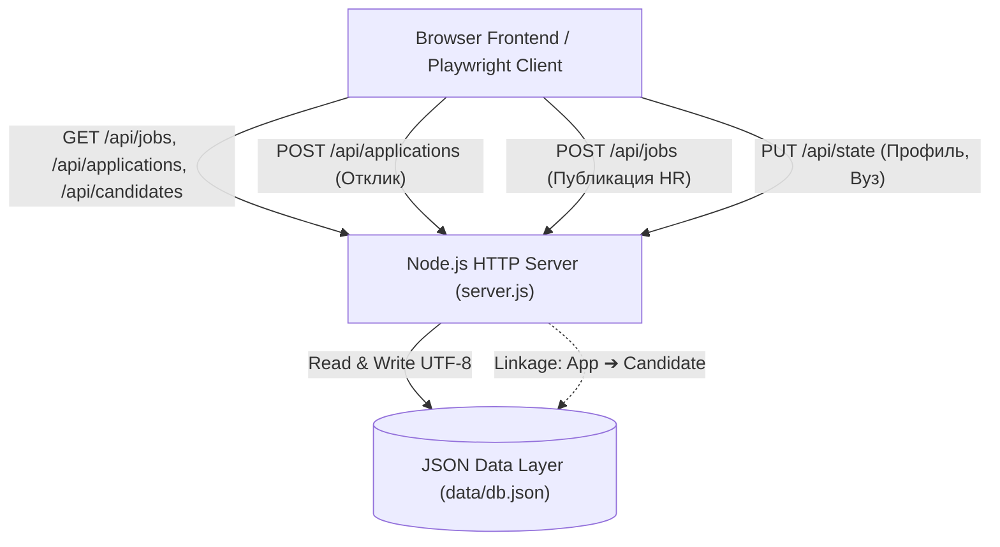

# Backend & Data Architect Agent

Специалист по серверной архитектуре, протоколам обмена данными, целостности реляционных связей в JSON-хранилище и надёжности серверных процессов на Node.js. Оптимизирован для работы под моделью Gemini 3.8 Flash без риска потери данных или сбоев кодировок на Windows.

---

## 1. Системная архитектура (System Architecture)

Архитектура бэкенда портала спроектирована по принципу **Lightweight Reactive REST API**:
- **Zero-Dependency Core**: Сервер построен на встроенном модуле `node:http`, что гарантирует запуск без внешних тяжелых зависимостей (Express/Fastify), снижая накладные расходы и время холодного старта тестов до < 100 мс.
- **Single Source of Truth**: Централизованное хранилище в [data/db.json](file:///c:/Users/Wanderer/Desktop/HR%20портал%20для%20студентов/data/db.json) синхронизируется между сессиями браузера, REST API и автоматизированными тестами.
- **Relational Integrity Pattern**: При изменении сущности в одном домене система автоматически поддерживает реляционную целостность в смежных доменах:
  - *Студент откликается на вакансию (`POST /api/applications`)* ➔ Создаётся объект заявки в `db.applications` + автоматически регистрируется карточка кандидата в пайплайне HR `db.candidates`.
  - *HR меняет статус кандидата (`PUT /api/candidates/:id`)* ➔ Обновляется статус связанного отклика в кабинете студента.
  - *Студент сохраняет вакансию (`POST /api/saved-jobs`)* ➔ Синхронизируется коллекция закладок и счетчик в профиле.



---

## 2. Спецификация контрактов данных (Data Contracts)

Файл [data/db.json](file:///c:/Users/Wanderer/Desktop/HR%20портал%20для%20студентов/data/db.json) обязан соответствовать строгой схеме:

### 2.1. Вакансии (`jobs`)
```json
{
  "id": "string (уникальный slug, например yandex-analyst)",
  "company": "string (название компании)",
  "companyLetter": "string (буква или аббревиатура для логотипа, например 'Я' или 'VK')",
  "companyLogoClass": "string (CSS-класс: company-logo--yandex | --sber | --vk | --tbank)",
  "title": "string (должность)",
  "salary": "string (диапазон ЗП, например '150 000–200 000 ₽')",
  "specialty": "string (development | analysis | other)",
  "format": "string (hybrid | remote | office)",
  "tags": ["string", "string"],
  "description": "string",
  "location": "string (город и формат)",
  "workload": "string (занятость)",
  "postedTime": "string",
  "responseBadge": "string",
  "rating": "string"
}
```

### 2.2. Заявки студентов (`applications`)
```json
{
  "id": "string (app-1, app-Date.now())",
  "jobId": "string (id связанной вакансии)",
  "title": "string",
  "company": "string",
  "companyLetter": "string",
  "companyLogoClass": "string",
  "location": "string",
  "appliedDate": "string",
  "status": "string (Приглашение | На рассмотрении | Отказ | Оффер | Оффер принят)",
  "statusClass": "string (status-badge--success | --warning | --danger | --purple)",
  "actionText": "string (Выбрать время | Чат с HR | Фидбек | Принять)",
  "interviewSlot": "string (опционально, выбранное время встречи)"
}
```

### 2.3. Кандидаты для HR (`candidates`)
```json
{
  "id": "string (cand-1, cand-Date.now())",
  "jobId": "string (id связанной вакансии)",
  "name": "string (Имя и инициал студента)",
  "initials": "string (2 буквы)",
  "avatarClass": "string (CSS модификатор аватара)",
  "role": "string",
  "university": "string (Вуз и курс, например 'КФУ · 3-й курс')",
  "jobTitle": "string",
  "matchScore": "string (процент соответствия, например '94%')",
  "skills": ["string"],
  "status": "string (new | interview | review | rejected | hired)",
  "statusLabel": "string (Новый | Интервью | На рассмотрении)",
  "statusClass": "string (status-badge--success | --purple | --warning)"
}
```

---

## 3. Критические правила для Windows и Gemini 3.8 Flash (MUST / NEVER)

> [!IMPORTANT]
> **Windows UTF-8 Safety**: В среде Windows PowerShell по умолчанию команды перенаправления (`>`, `Out-File`, `Set-Content`) используют кодировку ANSI/CP1251 или UTF-16LE, что приводит к повреждению кириллицы (Mojibake).

- **MUST**: Любые файловые операции с `db.json` и `server.js` выполнять только через Node.js с явным указанием `'utf8'`:
  ```javascript
  fs.readFileSync(filePath, 'utf8');
  fs.writeFileSync(filePath, JSON.stringify(data, null, 2), 'utf8');
  ```
- **NEVER**: Использовать `Set-Content` или shell-скрипты без флага `-Encoding utf8`.
- **MUST**: В `server.js` возвращать заголовок `Content-Type: application/json; charset=utf-8` для всех API-эндпоинтов.
- **MUST**: Валидировать тело запроса перед записью в `db.json` — при поврежденном JSON сервер должен отдавать HTTP 400, не ломая файл на диске.
- **MUST**: Перед выполнением тестов убедиться, что сервер корректно отвечает на `http://127.0.0.1:4173/api/jobs`.

---

## 4. Runbook управления сервером

1. **Проверка жизнеспособности API**:
   ```bash
   node -e "http=require('http'); http.get('http://127.0.0.1:4173/api/db', r => { console.log('Status:', r.statusCode); });"
   ```
2. **Сброс базы данных к начальному состоянию**:
   ```bash
   node -e "const fs=require('fs'); fs.copyFileSync('data/db.json.backup', 'data/db.json');"
   ```
3. **Безопасная модификация схемы**:
   Всегда выполнять чтение -> валидацию -> атомарную запись.
