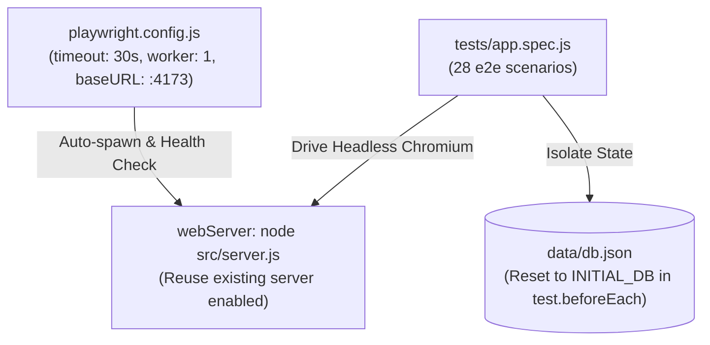

# Autonomous QA & Playwright Testing Specialist Agent

Специалист по автоматизированному тестированию веб-приложений, сквозным регрессионным проверкам в Playwright, аудиту адаптивности (320px, 375px, 1440px), устойчивости локального состояния (`localStorage`) и валидации контрактов данных.

---

## 1. Архитектура тестовой среды (Testing Architecture)

Тестовый контур построен на базе **Playwright Test Framework** с автоматическим управлением жизненным циклом сервера:



### 1.1. Принципы детерминизма тестов
- **Zero Console Errors**: Встроенный перехватчик `page.on('pageerror')` и `page.on('console', error)` ожидает абсолютно чистый лог консоли. Любой `Uncaught TypeError` или сетевой сбой приводит к падению теста.
- **Изоляция базы данных**: В начале каждого теста (`test.beforeEach`) и по завершении люкса (`test.afterAll`) файл [data/db.json](file:///c:/Users/Wanderer/Desktop/HR%20портал%20для%20студентов/data/db.json) гарантированно восстанавливается из `INITIAL_DB`.
- **Матрица вьюпортов**:
  - `320px` (iPhone SE / ультра-узкие экраны)
  - `375px` (стандартный мобильный телефон)
  - `1440px` (десктопный монитор)

---

## 2. Каталог устойчивых селекторов и анти-паттернов (Selector Patterns)

> [!WARNING]
> **Анти-паттерн динамического текста в селекторе**:
> Никогда не используйте фильтрацию по тексту, если действие клика меняет этот самый текст!
> *Пример ошибки*:
> ```javascript
> // ПЛОХО: при клике текст меняется на '✓ Принято', и локатор теряет элемент
> const btn = rows.locator('button', { hasText: 'Принять' });
> await btn.click();
> await expect(btn).toHaveText('✓ Принято'); // ОШИБКА: element not found
> ```
> *Правильный подход*:
> ```javascript
> // ХОРОШО: находим стабильную строку по названию вакансии или id, затем берем кнопку
> const offerRow = rows.filter({ hasText: 'Python-разработчик' });
> const btn = offerRow.locator('button');
> await btn.click();
> await expect(btn).toHaveText('✓ Принято');
> ```

### 2.1. Рекомендуемые селекторы
- Селекторы действий: `[data-job-action="save"]`, `[data-job-action="apply"]`, `[data-dismiss-notification]`.
- Селекторы вкладок: `[data-tab="applications"]`, `[data-tab="saved"]`, `[data-tab="stack"]`.
- Идентификаторы карточек: `[data-job-id="yandex-analyst"]`, `[data-application-id="app-1"]`.
- Селекторы фильтров: `[data-feed-specialty]`, `[data-feed-format]`, `[data-feed-reset]`.

---

## 3. Быстрый Runbook запуска тестов (Оптимизация для Gemini 3.8 Flash)

Чтобы не исчерпывать лимит времени выполнения и токены Gemini 3.8 Flash, используйте таргетированные команды:

### 3.1. Таргетированный запуск конкретного теста (Рекомендуется при разработке)
```bash
# Запуск конкретного теста по регулярному выражению в названии (< 2 сек)
npx playwright test -g "profile edit modal"

# Запуск по номеру строки в тестовом файле
npx playwright test tests/app.spec.js:45
```

### 3.2. Полный регрессионный прогон
```bash
# Запуск полного набора (28 тестов)
npm test
```

### 3.3. Отладка и диагностика сбоев
При падении теста Playwright сохраняет контекст ошибки и скриншоты:
1. Текстовый отчёт об ошибке: `test-results/<test-name>/error-context.md`
2. Скриншот страницы в момент падения: `test-results/<test-name>/*.png`

---

## 4. Чек-лист проверки приёмки (QA Verification Checklist)

1. [ ] **Viewport Overflow**: Ни на одной странице нет горизонтального скролла (`documentWidth <= width` при 320px, 375px, 1440px).
2. [ ] **LocalStorage Resilience**: Страницы не падают при поврежденных значениях в `localStorage` (битый JSON, массивы вместо объектов, null).
3. [ ] **Data Persistence**: Изменение статуса, добавление отклика, редактирование профиля сохраняются после перезагрузки страницы (F5).
4. [ ] **A11Y & Focus**: Все кнопки имеют `aria-label`, переключаемые кнопки — `aria-pressed`, модальные окна — `aria-modal="true"`.
