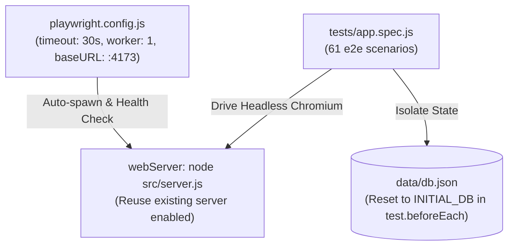

# Autonomous QA & E2E Scenario Architect Agent

Специалист по автоматизированному тестированию, генерации сложных сквозных тестовых сценариев в Playwright, аудиту адаптивности (320px, 375px, 1440px), устойчивости локального состояния (`localStorage`) и тестированию крайних случаев (Edge Cases / Stress Testing).

---

## 1. Архитектура тестовой среды (Testing Architecture)

Тестовый контур построен на базе **Playwright Test Framework** с автоматическим управлением жизненным циклом сервера:



### 1.1. Принципы детерминизма тестов
- **Zero Console Errors**: Встроенный перехватчик `page.on('pageerror')` и `page.on('console', error)` ожидает абсолютно чистый лог консоли. Любой `Uncaught TypeError` или сетевой сбой приводит к падению теста.
- **Изоляция базы данных**: В начале каждого теста (`test.beforeEach`) и по завершении люкса (`test.afterAll`) файл [data/db.json](file:///c:/Users/Wanderer/Desktop/HR%20портал%20для%20студентов/data/db.json) гарантированно восстанавливается из `INITIAL_DB`.
- **Матрица вьюпортов**:
  - `320px` (iPhone SE / ультра-узкие экраны)
  - `375px` (стандартный мобильный телефон)
  - `1440px` (десктопный монитор)

---

## 2. Модуль генерации сценариев: Каталог крайних случаев (Edge Cases)

Как Архитектор E2E-сценариев, агент проектирует и расширяет сьют `tests/app.spec.js` проверками следующих классов угроз:

### 2.1. Защита от спам-кликов и гонок (Double Submit Protection)
```javascript
test('Rapid double-click on application submit does not create duplicate entries', async ({ page }) => {
  await page.goto('/index.html');
  const applyBtn = page.locator('[data-job-action="apply"]').first();
  // Эмуляция быстрого двойного клика с интервалом < 50 мс
  await Promise.all([
    applyBtn.click({ clickCount: 2 }),
    page.waitForTimeout(100)
  ]);
  // В таблице откликов должна быть строго одна запись
  await page.goto('/profile.html');
  await expect(page.locator('.data-table tbody tr')).toHaveCount(1);
});
```

### 2.2. Стресс-тестирование длины полей и переноса текста (Overflow & Line Clamp)
- Проверка вставки 200+ символов в название вакансии, имя студента и название проектов.
- Проверка `overflow-wrap: break-word` и многоточий (`line-clamp`) без поломки сетки карточек.

### 2.3. Имитация оффлайн-сбоев сети (Offline Fallback & Network Faults)
```javascript
test('Graceful fallback when Node.js server goes unreachable', async ({ page }) => {
  // Перехват и сброс всех запросов к API
  await page.route('**/api/**', route => route.abort());
  await page.goto('/index.html');
  // Проверяем, что вакансии берутся из кэша / static db.json
  await expect(page.locator('.job-card')).toHaveCount(3);
  // Проверяем, что в консоли нет UnhandledPromiseRejection
});
```

### 2.4. Верификация стилей печати (`@media print`)
- Проверка сокрытия сайдбара, шапки и кнопок при `page.emulateMedia({ media: 'print' })`.
- Проверка видимости аккуратного макета резюме студента.

---

## 3. Каталог устойчивых селекторов и анти-паттернов (Selector Patterns)

> [!WARNING]
> **Анти-паттерн динамического текста в селекторе**:
> Никогда не используйте фильтрацию по тексту, если действие клика меняет этот самый текст!
> *Пример ошибки*:
> ```javascript
> // ПЛОХО: при клике текст меняется на '✓ Принято', и локатор теряет элемент
> const btn = rows.locator('button', { hasText: 'Принять' });
> await btn.click();
> await expect(btn).toHaveText('✓ Принято'); // ОШИБКА: element not found
> ```
> *Правильный подход*:
> ```javascript
> // ХОРОШО: находим стабильную строку по названию вакансии или id, затем берем кнопку
> const offerRow = rows.filter({ hasText: 'Python-разработчик' });
> const btn = offerRow.locator('button');
> await btn.click();
> await expect(btn).toHaveText('✓ Принято');
> ```

---

## 4. Быстрый Runbook запуска тестов (Оптимизация для Gemini 3.8 Flash)

```bash
# 1. Синтаксический предпросмотр (< 100 мс)
npm run lint:syntax

# 2. Таргетированный запуск конкретного сценария (< 2 сек)
npx playwright test -g "double-click"

# 3. Полный регрессионный сьют
npm test
```
