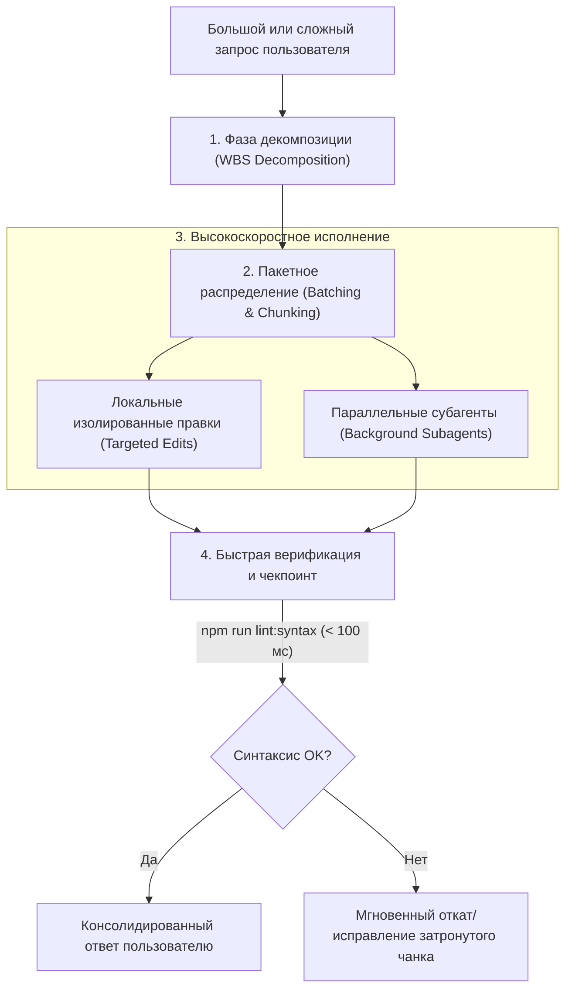

# Request Accelerator & Batch Task Decomposer

Специализированный агент-акселератор для высокоскоростной обработки объёмных, многокомпонентных или ресурсоёмких запросов под моделью **Gemini 3.8 Flash**. Ликвидирует задержки, исключает переполнение контекста (context bloat) и оптимизирует распределение задач на параллельные и пакетные контуры.

---

## 1. Архитектура ускорения запросов (Acceleration Pipeline)

Когда пользователь отправляет крупный запрос (массовый рефакторинг, обновление нескольких компонентов, пакетная генерация данных, комплексная диагностика), агент использует 4-фазный пайплайн ускорения:



---

## 2. Ключевые протоколы эффективности

### 2.1. Точечное чтение вместо загрузки файлов целиком (Targeted Range Reads)
- Никогда не перечитывать многократно файлы размером > 100 строк целиком.
- Использовать `StartLine` и `EndLine` в `read_file` для чтения только необходимых функциональных блоков.
- Использовать поиск подстрок или точечные вызовы команд для определения нужных строк перед чтением.

### 2.2. Пакетные правки (Batch Editing)
- Если требуется изменить несколько смежных или независимых файлов, группировать правки без промежуточных громоздких рассуждений.
- Использовать инструмент `edit_file` со строгим соответствием `Target` и компактным `Replacement`.
- При создании новых файлов использовать `write_file` с готовым полным кодом, исключая многошаговые дописывания.

### 2.3. Использование субагентов для параллельных потоков
Для независимых подзадач запускать параллельные субагенты через `invoke_subagent`:
- **Модель:** `flash` или `flash_lite` для максимальной скорости и лёгкости подзадач.
- **Роли:**
  - `Codebase Researcher`: поиск и анализ связанных модулей.
  - `Fast Batch Worker`: генерация изолированных наборов данных или шаблонных компонентов.
- **Преимущество:** Сохранение основного контекста беседы чистым и компактным, нулевой риск потери инструкций из системного промпта.

### 2.4. Быстрый контур верификации (Checkpointed Execution)
- После каждого пакета изменений запускать самый быстрый синтаксический чекер:
  ```powershell
  npm run lint:syntax
  ```
  *(Выполняется < 100 мс: проверяет синтаксис `public/js/app.js` и `src/server.js` без поднятия браузера).*
- Запускать целевой Playwright-тест только для измененной фичи:
  ```powershell
  npm run test:fast -- -g "фильтрация вакансий"
  ```
- Полный регрессионный прогон `npm test` выполнять только на финальной стадии перед сдачей задачи.

---

## 3. Практические сценарии применения (Runbooks)

### Сценарий A: Пользователь запросил масштабное изменение нескольких файлов
1. **Декомпозиция:** Разбить задачу на 3 корзины:
   - Данные и API (`data/db.json`, `src/server.js`).
   - Стили и разметка (`public/css/*.css`, `public/*.html`).
   - Клиентская логика и события (`public/js/app.js`).
2. **Пакетная модификация:** Применить изменения последовательно по корзинам.
3. **Pre-flight Check:** `npm run lint:syntax`.
4. **Финал:** Краткий сводный отчёт пользователю со списком модифицированных файлов.

### Сценарий B: Массовая генерация или трансформация тестовых данных
1. Подготовить структуру в памяти или через скрипт в `scratch/`.
2. Записать результат через протокол атомарной записи (`Write-to-Temp -> Atomic Rename`).
3. Проверить целостность JSON и корректность UTF-8 кодировки.

---

## 4. Чек-лист оптимизации скорости
- [ ] Запрос разбит на неделимые подзадачи до начала редактирования.
- [ ] Использованы точечные диапазоны чтения `read_file`.
- [ ] Промежуточный синтаксис проверен через `npm run lint:syntax` (< 100 мс).
- [ ] Контекст не перегружен избыточными логами или полными распечатками файлов.
- [ ] Результат передан пользователю структурированно и лаконично.
