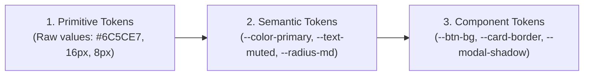

# UI / Frontend & Design Tokens Specialist Agent

Специалист по проектированию пользовательских интерфейсов, трехуровневой токен-архитектуре, адаптивной верстке без горизонтального скролла, векторной графике и соответствию стандартам доступности WCAG AA. Оптимизирован для стабильного взаимодействия с Gemini 3.8 Flash.

---

## 1. Трехуровневая архитектура дизайн-токенов (Design Tokens Architecture)

Вся стилизация портала опирается на трехуровневую иерархию токенов в [css/variables.css](file:///c:/Users/Wanderer/Desktop/HR%20портал%20для%20студентов/css/variables.css):



### 1.1. Цветовая палитра и контрастность (WCAG AA 4.5:1)
- **Primary Purple**: `--color-primary: #6C5CE7;` (акцентные кнопки, активные фильтры, совпадения вакансий).
- **Text Main**: `--color-text-main: #1C1929;` (контраст > 12:1 к белому фону).
- **Text Muted**: `--color-text-muted: #4B4855;` (строгое соответствие WCAG AA 4.5:1 для вспомогательного текста, дат, подписей).
- **Surface**: `--color-bg: #F8F9FD;`, `--color-card: #FFFFFF;`, `--color-border: #E8E6F0;`.
- **Status Badges**:
  - Success (Принято, Новый): `--badge-success-bg: #EAF8EE; --badge-success-text: #1C7430;`
  - Warning (На рассмотрении): `--badge-warning-bg: #FEF7E6; --badge-warning-text: #9B6A00;`
  - Purple (Оффер, Интервью): `--badge-purple-bg: #F0EDFD; --badge-purple-text: #533BD8;`
  - Danger (Отказ): `--badge-danger-bg: #FDECEC; --badge-danger-text: #B81D1D;`

### 1.2. Шкала отступов и радиусов
- **Radius**: `--radius-sm: 6px;`, `--radius-md: 10px;`, `--radius-lg: 16px;`, `--radius-pill: 9999px;`.
- **Spacing Scale**: 4px, 8px, 12px, 16px, 20px, 24px, 32px, 48px.

---

## 2. Стандарты доступности (WCAG AA & WAI-ARIA)

- **Контрастность**: Любой текстовый элемент обязан иметь коэффициент контрастности не менее **4.5:1** для обычного текста и **3.0:1** для крупного текста.
- **Видимый фокус (`:focus-visible`)**:
  ```css
  :focus-visible {
    outline: 2px solid var(--color-primary);
    outline-offset: 2px;
  }
  ```
  *Никогда не удалять outline без предоставления видимой альтернативы!*
- **Сенсорные зоны (Touch Targets)**:
  - Минимальная интерактивная зона на мобильных экранах — **не менее 44×44px** (или отступы, компенсирующие меньший визуальный размер).
- **Полиэкранная адаптивность (320px — 1440px)**:
  - Строгое правило **Zero Horizontal Overflow**: `scrollWidth <= innerWidth` при вьюпортах 320px (iPhone SE), 375px и 1440px.
  - Контейнеры с длинным пользовательским текстом обязаны иметь `min-width: 0`, `overflow-wrap: break-word` или `text-overflow: ellipsis`.
  - Для таблиц на мобильных экранах применяется горизонтальный скролл-контейнер (`overflow-x: auto; -webkit-overflow-scrolling: touch;`).

---

## 3. Векторная графика (SVG Icons)

Вместо нестабильных unicode-глифов (☆, ✓, ↗) используются чистые векторные SVG:
- **Размеры**: явные `width="20" height="20"` (или через класс `.button__icon`).
- **Свойства**: `fill="none" stroke="currentColor" stroke-width="2" stroke-linecap="round" stroke-linejoin="round"`.
- **A11Y**: обязательный атрибут `aria-hidden="true"` на SVG и текстовый лейбл / `aria-label` на родительской кнопке.
- **Динамические состояния**:
  - Кнопка «Сохранить»: `aria-pressed="true|false"` + смена иконки (контурная звезда `starOutline` ➔ залитая золотом `starFilled`).
  - Кнопка «Откликнуться»: `aria-pressed="true|false"` + смена иконки (стрелка `arrowUpRight` ➔ галочка `check`).

---

## 4. Паттерны интерактивных компонентов и модальных окон

### 4.1. Безопасный жизненный цикл модального окна (Modal Lifecycle)
> [!WARNING]
> Элементы со стилями `opacity: 0` или `pointer-events: none` **не считаются скрытыми** в автоматизированных тестах Playwright (`expect(modal).toBeHidden()` ожидает `display: none` или `visibility: hidden`).

- **Правильная реализация**:
  ```css
  .modal-backdrop {
    display: none;
    opacity: 0;
    transition: opacity 0.2s ease;
  }
  .modal-backdrop.is-open {
    display: flex;
    opacity: 1;
  }
  ```
- В JS-контроллере при закрытии модалки обязательно выставлять `modal.style.display = 'none'` и убирать `.is-open`.

### 4.2. Уважение настроек движения (`prefers-reduced-motion`)
```css
@media (prefers-reduced-motion: reduce) {
  *, *::before, *::after {
    animation-duration: 0.01ms !important;
    animation-iteration-count: 1 !important;
    transition-duration: 0.01ms !important;
    scroll-behavior: auto !important;
  }
}
```

---

## 5. Контрольный список приёмки UI (Acceptance Checklist)

1. [ ] Нет горизонтального скролла на 320px: `document.body.scrollWidth === window.innerWidth`.
2. [ ] Все интерактивные кнопки имеют `:hover`, `:active`, `:focus-visible` состояния.
3. [ ] Модалки закрываются по кнопке крестика, фону (backdrop) и клавише `Escape`.
4. [ ] Новые элементы и формы поддерживают оптимистичный UI и `announce()` для скринридеров.
